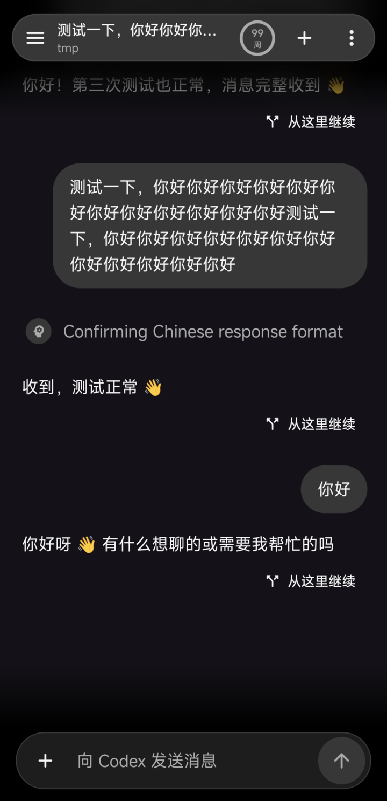
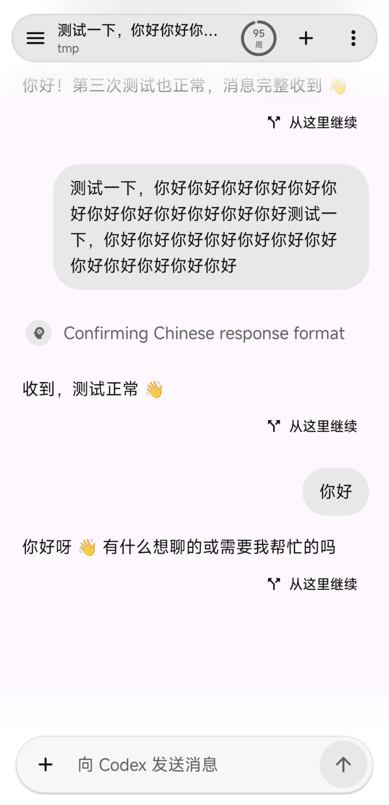
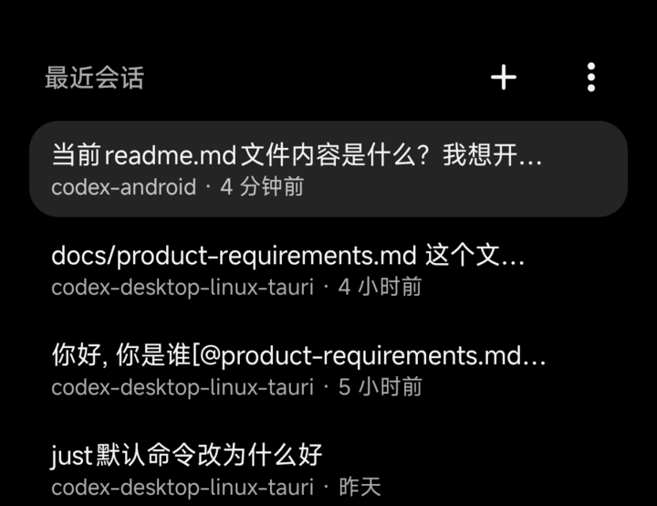
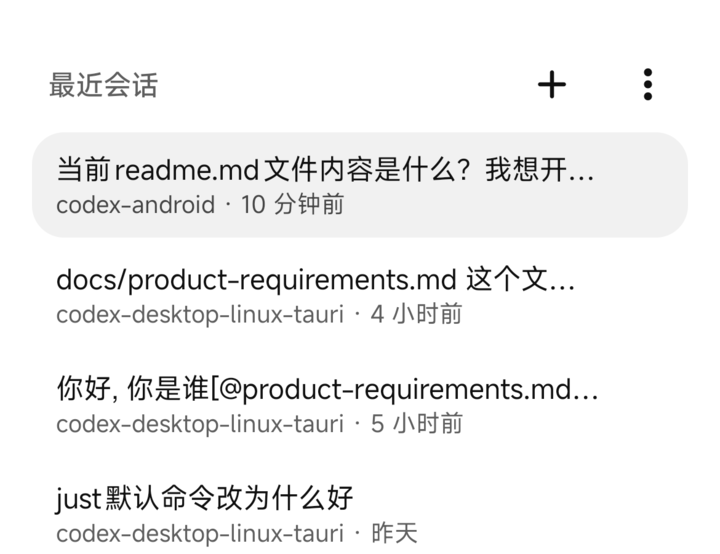
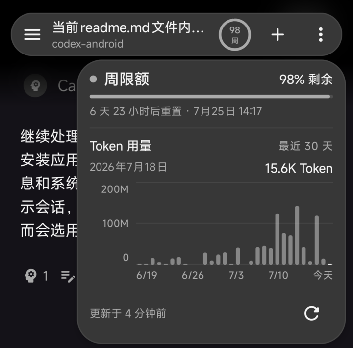
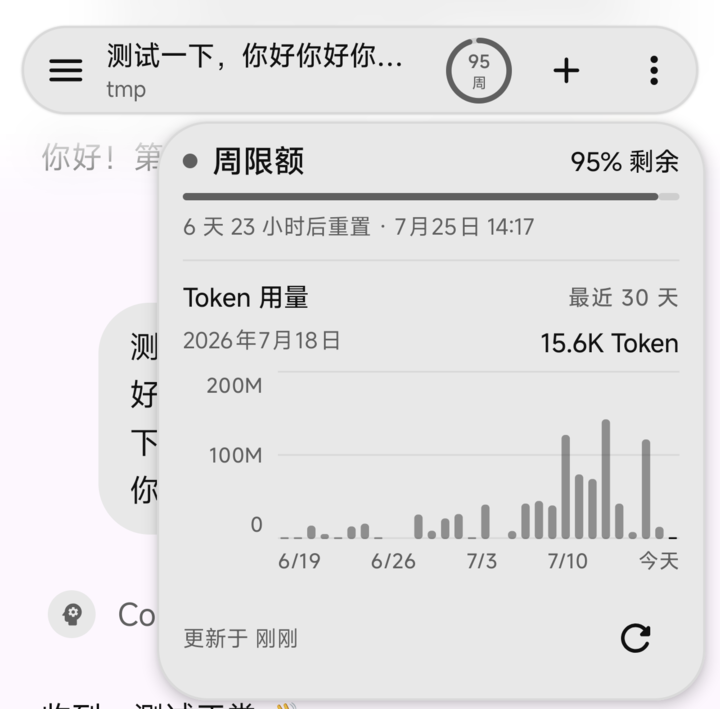

# Codex Android

Codex Android 是基于 Codex app-server 的非官方原生 Android 客户端，让你可以通过 Android 设备连接并操作自己的 Codex 服务端

> [!WARNING]
> 本项目不是 OpenAI 官方产品，与 OpenAI 没有关联或背书
>
> 项目目前处于早期开发阶段，功能和兼容性可能随 Codex app-server 演进而调整

## 截图

| 页面 | 深色模式 | 浅色模式 |
| --- | --- | --- |
| 会话与流式活动 |  |  |
| 侧边栏最近会话 |  |  |
| 限额圆环详情 |  |  |

## 项目状态

- 最低支持 Android 8.0（API 26）
- 可从 [GitHub Releases](https://github.com/hebo6/codex-android/releases/latest) 下载正式 APK
- app-server WebSocket 传输本身仍是实验性接口，不建议用于生产环境

## 功能

- 添加、编辑、删除并切换多个 Codex 服务端
- 使用 Android Keystore 加密保存 capability token
- 按项目组织、搜索、恢复、重命名、分叉、归档和删除会话
- 保存新任务和会话草稿，并选择服务端项目目录提交任务
- 流式展示回复、推理、计划、命令执行、文件修改和工具活动
- 处理命令、文件、权限审批、用户问题和 MCP 确认请求
- 配置模型、推理强度、人格、审批策略、审批者和沙箱权限
- 支持设备图片、图片地址、Skills、Apps、Plugins、快捷短语和 Shell 输入
- 预览、保存和分享服务端文件与图片
- 查看账号、使用额度和 Token 用量，并管理 Skills、Plugins 与 MCP 服务
- 支持任务完成与待审批通知
- 自动适配浅色和深色主题

## 使用要求

- 运行应用需要 Android 8.0 或更高版本
- 服务端需要提供与当前客户端兼容的 Codex app-server
- Android 设备需要能够访问服务端 WebSocket 地址
- 非本机连接需要使用 TLS、SSH 端口转发或其他可信网络通道

## 配置服务端

准备一个仅当前用户可读的高强度随机 capability token 文件，例如使用 OpenSSL 生成

```bash
umask 077
openssl rand -hex 32 > "$HOME/.codex/app-server-token"
```

将下面的示例 IP 替换为服务端实际局域网 IP，然后启动 app-server

```bash
CODEX_LISTEN_IP=192.168.1.100

codex app-server \
  --listen "ws://${CODEX_LISTEN_IP}:8390" \
  --ws-auth capability-token \
  --ws-token-file "$HOME/.codex/app-server-token"
```

在应用中填写 `ws://192.168.1.100:8390`，并粘贴 token 文件中的原始内容

## 安全说明

- `ws://` 不提供传输加密，令牌和消息内容可能被同一网络中的其他设备截获
- 远程连接应通过 TLS 终止代理提供 `wss://`，或使用 SSH 端口转发
- 不要将 app-server 直接暴露在公共网络或不可信的共享网络中
- capability token 仅用于客户端到 app-server 的连接认证，不要复用 Codex 账号凭据或 OpenAI API Key
- capability token 在 Android 设备上使用 Android Keystore 和 AES-GCM 加密保存

## 构建

构建环境要求

- JDK 26
- Android SDK 37
- 使用仓库提供的 Gradle Wrapper，无需单独安装 Gradle

构建 Debug APK

```bash
./gradlew :app:assembleDebug
```

生成的 APK 位于 `app/build/outputs/apk/debug/app-debug.apk`

通过 Android SDK Platform Tools 安装 APK

```bash
adb install -r app/build/outputs/apk/debug/app-debug.apk
```

运行单元测试

```bash
./gradlew :app:testDebugUnitTest
```

## 协议

客户端使用省略 `jsonrpc` 字段的 JSON-RPC 2.0 消息，并在每条连接上完成 `initialize` 和 `initialized` 握手

承载 Android 连接的 WebSocket 传输由上游标记为 experimental 和 unsupported

协议详情参见 [Codex App Server 文档](https://learn.chatgpt.com/docs/app-server) 和 [Codex app-server 源码](https://github.com/openai/codex/tree/main/codex-rs/app-server)

## 技术栈

- Kotlin 2.3 与 Android Gradle Plugin 9 内置 Kotlin
- Jetpack Compose 与 Material 3
- Navigation Compose 类型安全路由
- Coroutines 与 StateFlow
- Room 与 DataStore Preferences
- Android Keystore AES-GCM
- OkHttp WebSocket
- kotlinx.serialization JSON

## 工程结构

```text
app/src/main/java/com/hebo/codex
├── data/local     本地数据库、服务端配置与 Token 加密
├── data/remote    WebSocket、JSON-RPC 与协议映射
├── domain         仓库、会话状态与业务模型
└── ui             Compose 页面、组件与主题
```

## 贡献

欢迎通过 Issue 报告问题或提出建议，也欢迎提交 Pull Request。涉及较大范围的功能或架构调整时，建议先通过 Issue 讨论方案

## 许可证

本项目基于 [Apache License 2.0](LICENSE) 开源
